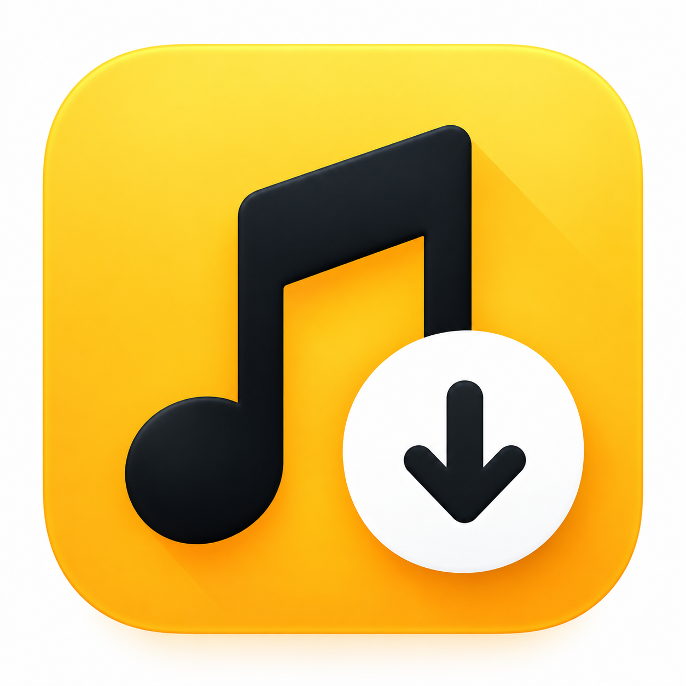
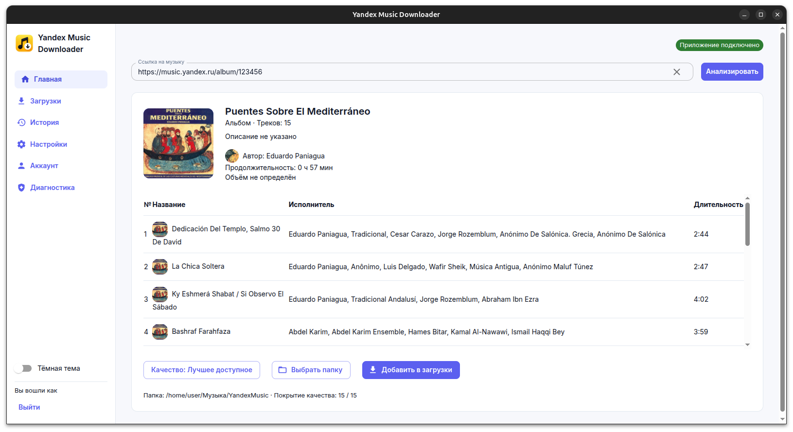

  

<h1 align="center">Yandex Music Downloader</h1>

  <strong>Любимая музыка — в вашей коллекции 🎶</strong> 
  Треки, альбомы и плейлисты Яндекс Музыки с обложками, тегами и удобной очередью загрузок.

  🪟 <strong>Windows</strong> · 🍎 <strong>macOS</strong> · 🐧 <strong>Linux</strong>

  <a href="https://github.com/yarkovaleksei/yandex-music-downloader/releases">📦 Скачать приложение</a>
  &nbsp; · &nbsp;
  <a href="docs/README.md">📚 Документация</a>
  &nbsp; · &nbsp;
  <a href="LICENSE">MIT License</a>

---

Собрать любимый плейлист для дороги, сохранить альбом целиком или забрать один трек — вставьте ссылку, выберите папку и добавьте музыку в загрузки. Приложение сохраняет музыку, доступную вашему аккаунту Яндекс Музыки, и помогает сразу получить аккуратную локальную коллекцию.

Перед загрузкой видно, что именно вы сохраняете: состав плейлиста, исполнителей, длительность и доступное качество. Дальше приложение займётся файлами, метаданными и обложками, а вы сможете следить за очередью или поставить её на паузу.

<picture>
  <source media="(prefers-color-scheme: dark)" srcset="docs/images/album-preview-dark.png">
  <source media="(prefers-color-scheme: light)" srcset="docs/images/album-preview-light.png">
  
</picture>

*Предпросмотр альбома в приложении: состав, длительность, качество и папка для сохранения — перед началом загрузки.*

[☀️ Светлая тема](docs/images/album-preview-light.png) · [🌙 Тёмная тема](docs/images/album-preview-dark.png)

## ✨ Что умеет

| | Для вашей музыкальной коллекции |
| --- | --- |
| 🎵 **Треки, альбомы и плейлисты** | Сохраняйте один трек или целую коллекцию по ссылке из Яндекс Музыки. |
| 🎚️ **Выбор качества** | Выбирайте лучшее доступное качество, предпочтение lossless или конкретный вариант из доступных для трека. |
| 🏷️ **Теги и обложки** | Названия, исполнители, альбомы, номера треков и изображения сохраняются вместе с музыкой. Отдельный `cover.jpg` — по вашему выбору. |
| 📁 **Порядок в файлах** | Настройте папку и схему имён. Для плейлиста можно создать `.m3u8`, чтобы открыть его в привычном проигрывателе. |
| ⏯️ **Управляемая очередь** | Пауза, продолжение, отмена, повтор и параллельные загрузки. После прерывания можно вернуться к сохранённому заданию. |
| 🕘 **История под рукой** | Ищите прошлые загрузки, фильтруйте по датам, повторяйте их и открывайте папку с результатом. |
| 🌗 **Светлая и тёмная темы** | Выбирайте оформление под себя — для дневной работы и вечерних музыкальных раскопок. |
| 🧰 **Окно приложения и CLI** | Пользуйтесь графическим интерфейсом или включайте загрузчик в свои сценарии через командную строку. |

## 🚀 От ссылки до музыки — три шага

1. **Скачайте приложение** со [страницы релизов](https://github.com/yarkovaleksei/yandex-music-downloader/releases): exe для Windows, архив для macOS, AppImage для Linux.
2. **Войдите в аккаунт Яндекс Музыки.** Подтвердите вход в браузере — пароль вводится на стороне Яндекса, приложение его не запрашивает.
3. **Вставьте ссылку и начните загрузку.** Посмотрите состав коллекции, выберите качество и папку. Готовые файлы останутся у вас с тегами и обложками.

Параметры тегов, обложек и плейлистов можно настроить под свою библиотеку. Приложение запоминает настройки, а история помогает вернуться к уже сохранённой музыке.

## 📚 Документация

[Оглавление документации](docs/README.md) — возможности приложения, работа с CLI, настройка для разработки, архитектура и требования.

## 💛 Благодарности

Спасибо [thedvxch](https://github.com/thedvxch) за библиотеку [@dvxch/yandex-music](https://github.com/thedvxch/yandex-music), на которой построена интеграция с Яндекс Музыкой. Его работа помогла превратить этот проект в приложение, которым приятно пользоваться.
